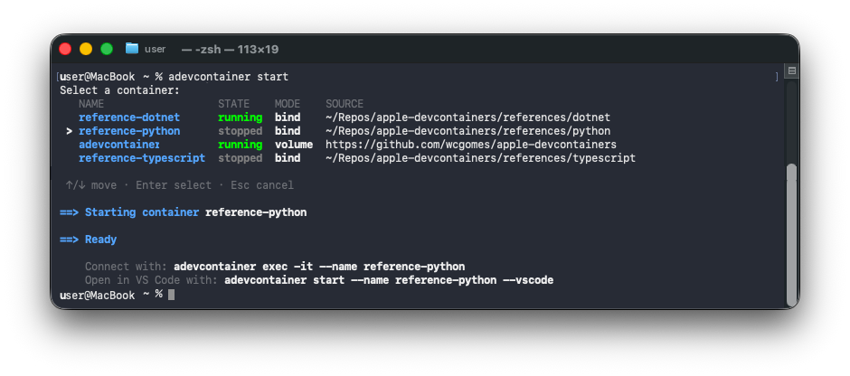
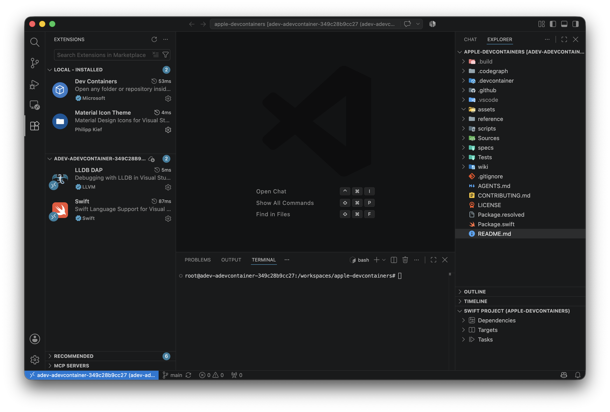

# Apple Dev Container CLI (adevcontainer)

[](https://github.com/wcgomes/apple-devcontainers/actions/workflows/ci.yml)
[](https://github.com/wcgomes/apple-devcontainers)
[](LICENSE)

Native Swift CLI that reads `devcontainer.json` and runs development environments on Apple [`container`](https://github.com/apple/container).

Use `up` with an existing checkout, or use `clone` to keep the repository in a named volume for faster I/O. Work from your terminal, an AI agent or VS Code.



For implementation details and behavior beyond this quick reference, see the [technical documentation](wiki/index.md).

## Requirements

- macOS 26+ on Apple Silicon
- Apple [`container`](https://github.com/apple/container), installed separately

## Install

### Homebrew (recommended)

```bash
brew install wcgomes/tap/adevcontainer
sudo adevcontainer plugin --install
```

Run `sudo adevcontainer plugin --install` once after install, and again only after upgrading Apple `container`. `brew upgrade adevcontainer` does not require `plugin --install` again when the plugin symlink already targets `$(brew --prefix)/opt/adevcontainer/bin/adevcontainer`.

### Release binary

Download `adevcontainer-macos-arm64.tar.gz` and `adevcontainer-macos-arm64.tar.gz.sha256` from [GitHub Releases](https://github.com/wcgomes/apple-devcontainers/releases), then run:

```bash
shasum -a 256 -c adevcontainer-macos-arm64.tar.gz.sha256
tar xzf adevcontainer-macos-arm64.tar.gz
sudo mv adevcontainer /usr/local/bin/ # or move it to another directory on PATH
sudo adevcontainer plugin --install    # sudo when the plugin destination requires elevation
```

Verify the installation and Apple `container` setup:

```bash
adevcontainer doctor
```

To build from source, follow [CONTRIBUTING.md](CONTRIBUTING.md).

## Quick start

Your project must contain `.devcontainer/devcontainer.json` or `.devcontainer.json`.

### Use a local checkout

From the project directory:

```bash
adevcontainer up
adevcontainer exec
```

> **Tip:** Apple Containers works differently from other container runtimes: it uses a lightweight VM per container instead of sharing one super VM, but its default resources can be low or insufficient for dev containers; if a container is unresponsive, consider setting `hostRequirements` in `devcontainer.json`.

To use another local directory, run `adevcontainer up -w <path>`.

### Clone into a named volume

You do not need a local checkout. Use an HTTPS or SSH Git URL:

```bash
adevcontainer clone https://github.com/org/repo.git
adevcontainer exec
```

The cloned source remains in a named volume. You can work, commit, and push from inside the container.
If bring-up fails after the config-only fetch, the CLI retains that checkout for recovery. On a
TTY it offers to open and retry the config; in automation, edit the printed path and run the exact
`adevcontainer clone <git-url> --resume <config-dir>` command.

## Apple container plugin

After `adevcontainer plugin --install`, every command also works as `container dev <subcommand>`. PATH `adevcontainer` remains valid. `plugin --uninstall` removes only the plugin `bin/dev` link and `config.toml`.

Apple must be running to dispatch plugins:

```bash
container system start
```

Examples:

```bash
container dev up
container dev exec
container dev list
container dev doctor
```

Apple upgrades wipe the plugin directory. PATH `adevcontainer` survives. Restage with PATH `adevcontainer plugin --install` (`sudo` when the destination requires elevation), again only after upgrading Apple `container`. `brew upgrade adevcontainer` does not require restage when the symlink already targets the Homebrew opt path.

## Commands

### Interactive picker

The `start`, `exec`, `stop`, `delete`, `purge`, `rebuild`, and `inspect` commands open an interactive picker (picklist) in an interactive TTY when `--name` is not provided and multiple managed containers exist. In a non-interactive terminal, `--name <name>` is required in this case.

| Command | Purpose |
| --- | --- |
| `adevcontainer doctor` | Check Apple `container` readiness |
| `adevcontainer plugin --install` | Link the Apple CLI plugin (`bin/dev` absolute symlink and `config.toml`) |
| `adevcontainer plugin --uninstall` | Remove plugin `bin/dev` and `config.toml` only |
| `adevcontainer up [-w <path>] [--vscode]` | Create or start a dev container from a local folder |
| `adevcontainer clone <git-url> [--vscode] [--resume <config-dir>]` | Clone a repository into a named volume and start its dev container |
| `adevcontainer exec [-it] [--name <name>] [--] [cmd…]` | Open a shell or run a command in a running managed container |
| `adevcontainer list [--json]` | List managed dev containers |
| `adevcontainer start [--name <name>] [--vscode] [--json]` | Start a managed container; prepare or repair automatic Git credentials, including running reuse |
| `adevcontainer stop [--name <name>]` | Stop a container by name or with the interactive picker |
| `adevcontainer inspect [--name <name>]` | Inspect a container by name or with the interactive picker |
| `adevcontainer delete [--name <name>]` | Remove a container, keeping its managed volumes |
| `adevcontainer purge [--name <name>]` | Remove a container, its managed volumes, and the image |
| `adevcontainer rebuild [--name <name>] [--vscode]` | Rebuild a managed container from its current configuration |
| `adevcontainer help [<command>]` | Show main usage or per-command help |
| `adevcontainer version [--version]` | Print the CLI version |

### Automatic Git credentials

For discovered HTTP(S) Git destinations, lifecycle commands connect the resolved
container user to the existing host credential provider before hooks; clone does
so before its single in-container full clone. Credentials travel on private
exec/socket channels, not guest token stores, argv or product-created environment
variables. Git/GCM interaction on the host is disabled and acquisition is bounded.

The same installed CLI starts a per-user broker process on demand, without sudo,
before the first credential-dependent lifecycle work. It runs in its own session,
survives the invoking CLI, and exits after five seconds without demand. Nothing is
installed and nothing restarts it: a crash is recovered by the next `up`, `start`,
clone, or rebuild. The next activation reuses a broker from the same executable and
gracefully replaces one from an older build. Registrations on disk contain
identity/destinations, not credentials; explicit host token overrides live only in
memory and require re-registration after the broker exits. No separate guest package,
Python, socat, GCM, translator or compiler is installed at runtime.

Authorization binds the discovered scheme/hostname/port, preserving sibling paths.
Legacy HTTP is retained only when discovered; HTTPS never authorizes HTTP and no
unsafe-HTTP provider option is enabled. Azure retains scheme-specific helper and
useHttpPath configuration and receives the actual queried repository path.
Earlier user/legacy helpers remain in order and may answer first; those answers
are outside the product helper's freshness guarantee. Unmarked legacy clone stores
are not deleted. The identified old product-owned seed store is migrated away.

`start` and `up` on an already-running container repair the automatic
connection without fetch/pull/push or workspace writes. They do not clear
rejection suppression. To clear that finite block, stop the container and
start it again. A provider miss remains a miss. If login is needed, authenticate
on the host and retry. An unchanged token does not prove OAuth renewal.
Replacing or moving the executable is detected by identity. The next ordinary
lifecycle invocation compares the running broker's executable device/inode and
build identity with the invoking executable, retires a mismatched owner, and
starts a successor from the current executable.

### Source builds

On macOS 26+ Apple Silicon with Swift/CLT, curl, tar/xz and SHA-256 tools:

```sh
sh scripts/build-guest-credential-relay.sh
swift build -c release --product adevcontainer
```

Preparation downloads only the official checksum-pinned Zig 0.15.2 toolchain into
`.build/toolchains/zig-0.15.2/` (initial HTTPS access to ziglang.org is required).
Every use verifies the archive and extracts a fresh private compiler/sysroot;
installed Zig is not consulted. Both static linux/arm64 and linux/amd64 helpers
are verified and embedded in generated, gitignored Swift source. Build outputs
and toolchains are not runtime dependencies. Source/CI builds must prepare these
assets first; releases remain one relocatable CLI plus license notices.

## Bring-up recovery

When `up` or `clone` cannot bring up a container after an editable `devcontainer.json` exists,
interactive TTY mode prints the structured failure, asks `Open the recovery editor now? [Y/n]`,
and retries the complete create path after a valid edit. Declining or EOF returns the original
failure. Non-TTY and `--json` never prompt or edit; `up` prints a host-config retry hint, while
`clone` retains its config checkout and prints an exact `clone --resume` command.

If `start` cannot start a selected managed container, TTY recovery asks the same question and
delegates to `rebuild --name <name>`; it never re-runs `start` or opens an editor. Non-TTY,
`--json`, decline, and EOF return the original start failure with the rebuild hint.

## Visual Studio Code integration

`up`, `clone`, and `rebuild` apply supported `customizations.vscode.settings` and `customizations.vscode.extensions` from `devcontainer.json` by default (soft-fail; not full Dev Containers extension parity). `start` does not apply settings or extensions.

`--vscode` only opens a new VS Code window on the remote workspace and gates `postAttachCommand`. Install the [Remote - Containers extension](https://marketplace.visualstudio.com/items?itemName=ms-vscode-remote.remote-containers) and make sure the `code` CLI is available:

```bash
adevcontainer up --vscode
```



## Contributing

See [CONTRIBUTING.md](CONTRIBUTING.md) for prerequisites, source builds, tests, fixtures, and the repository development workflow.

Technical design and project decisions are documented in the [wiki](wiki/index.md).

## License

This project is available under the [MIT License](LICENSE).
